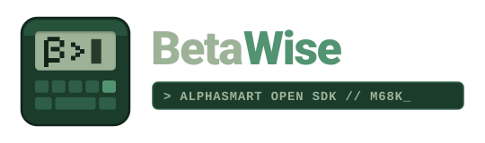

Custom applets for the **AlphaSmart 3000, NEO, and NEO2**, plus an SDK and research
for people who want to make their own.

## Download applets

You don't need a compiler to use BetaWise applets.

- **Released applets:** open [Releases](https://github.com/betawise/betawise/releases)
  and download the `betawise-applets-*.zip` asset. Unzip it to find the
  `.OS3KApp` files. GitHub's “Source code” downloads are for developers.
- **Latest development builds:** open [CI runs](https://github.com/betawise/betawise/actions/workflows/ci.yml),
  choose a successful run for `master`, and download its `betawise-applets-*`
  artifact. GitHub requires you to sign in to download artifacts, and older
  artifacts may expire. These builds include work newer than the releases.

The latest tagged release is **v0.2 (2021)**; it predates the MicroPython and
UCBLogo applets described below. Use a current development build for those.

## Installing custom applets

Connect your device with a USB cable and back up your documents before changing
installed applets. Choose an installer below.

### Linux / macOS: neotools

[neotools](https://github.com/lykahb/neotools) is a command-line alternative to
Manager for the AlphaSmart 3000, NEO, and NEO2. Applet installation is marked
as experimental, but it is verified working by many users.

On Debian/Ubuntu, install Python's virtual-environment support and libusb:

```sh
sudo apt-get install python3-venv libusb-1.0-0
```

On macOS, install Python 3 and libusb with [Homebrew](https://brew.sh):

```sh
brew install python libusb
```

Then, on either system, install neotools in its own environment:

```sh
python3 -m venv ~/.venvs/neotools
source ~/.venvs/neotools/bin/activate
python -m pip install neotools
```

With your device connected, check the connection, export your AlphaWord documents,
and install a downloaded applet (replace the example path with your own):

```sh
neotools info
mkdir -p ~/neo-backup
neotools files read-all --path ~/neo-backup/
neotools applets install ~/Downloads/HelloWorld.OS3KApp
```

Read and answer the installation confirmation, then wait for completion before
disconnecting. To use neotools in a new terminal, run the `source` command above
again. For Linux USB permission errors, follow the upstream
[udev instructions](https://github.com/lykahb/neotools#access-denied).
The document export saves AlphaWord text; it is not a complete device backup.

### Windows: NEO Manager / AlphaSmart Manager

Use NEO Manager for NEO/NEO2, or an AS3000-compatible AlphaSmart Manager with
System 3 firmware for the 3000. The legacy
[NEO Manager download page](https://support.renaissance.com/techkb/techkb/13002475e.asp)
may no longer be available.

Once Manager recognizes your device:

1. Choose **File → Add to Applet List…** and select the `.OS3KApp` file.
2. In **SmartApplets**, select the applet and click **Add**.
3. In **Send List**, click **Send** and wait for completion.

Leave **Delete SmartApplets that are not in the Install List…** unchecked
unless you intend to remove other installed applets.

If you can't get Manager working, neotools is another option and can run
natively on Windows with Python and a suitable USB backend. See the
[neotools commands above](#linux--macos-neotools) and the
[PyUSB installation guide](https://github.com/pyusb/pyusb#installing) for USB
backend setup.

### After installation

Disconnect the USB cable, press **Applets**, and choose the installed applet.
On NEO/NEO2, also install `NeoFontTerminal.OS3KApp` for MicroPython and UCBLogo.
The AS3000 uses its built-in text display and does not need this font applet.
The [font guide](applets/NeoFontTerminal/README.md) describes the optional
Small and Tiny variants; install only one font variant at a time because they
share an applet ID.

## What can I run?

✓ = supported model; — = not supported. These columns describe applet
compatibility, not a claim that every model has been tested on physical hardware.
AS3000 applets require System 3 firmware.

| Applet | 3000 | NEO | NEO2 | What it does |
| --- | :---: | :---: | :---: | --- |
| [MicroPython](applets/MicroPython/README.md) | ✓ | ✓ | ✓ | An interactive Python prompt, with four profiles to choose from. See the guide for features, keys, and limitations. |
| [UCBLogo](applets/UCBLogo/README.md) | — | ✓ | ✓ | Turtle graphics and small Logo procedures. Requires the NEO graphics display. |
| [Terminal Font](applets/NeoFontTerminal/README.md) | — | ✓ | ✓ | Monospaced fonts for more characters on the screen; also usable in AlphaWord. |
| [Hello World](applets/HelloWorld/README.md) | ✓ | ✓ | ✓ | A minimal demonstration applet and starting point for developers. |
| [DebugTool](applets/DebugTool/README.md) | ✓ | ✓ | ✓ | Low-level tools for firmware and SDK development. |
| [File Manager](applets/FileManager/README.md) | ✓ | ✓ | ✓ | An experimental file browser with rename, move, and delete operations. Read its prototype limitations before use. |

To open the applet chooser at power-on, hold **Left Shift + Tab** while turning
on the device.

## Build from source

The supported toolchain is Debian/Ubuntu's **`m68k-linux-gnu-gcc`**. Follow the
[CI workflow](.github/workflows/ci.yml) for the current build environment,
dependencies, submodule initialization, build commands, and runtime checks.
Use a Git checkout with tags available, as CI does, for version generation.

Applet images are written to `applets/<name>/*.OS3KApp`. Install them using the
steps above. See the individual applet guides for build options.

### Windows and other toolchains

On Windows, WSL with Debian or Ubuntu lets you follow the CI build. Native
Windows builds are not covered by CI.

[MinGW GCC for M68K](https://sourceforge.net/projects/mingw-gcc-68k-elf/)
13.1.0 was tested under Wine 11 with a 32-bit prefix in November 2026. It built
the SDK, HelloWorld, DebugTool, File Manager, and all three terminal fonts, and
passed the QEMU relocation/startup, ABI bridge, setjmp, and arithmetic checks.
However, the complete applet build failed: MicroPython hit an internal compiler
error in `gc_setup_area`, and UCBLogo encountered incompatible newlib
`stdin`/`stdout`/`stderr` macros. This is **partial toolchain compatibility**,
not a verified native Windows build; use the Debian/Ubuntu toolchain for the
complete build.

To experiment with another toolchain, override the prefix, for example:

```sh
make CROSS_COMPILE=m68k-elf-
```

The build also needs a Unix-style shell, Make, Python 3, and host utilities.
Changing the prefix alone does not provide a native Windows build environment.

### SDK notes

`libos3k.a` supplies 68000 integer and soft-float helpers through the normal
applet link. See the [compiler runtime notes](os3k/compiler-rt/README.md)
for the source pin and arithmetic test.

OS3K applets must support two-byte alignment for their RAM and flash bases.
Firmware placement may put either base two bytes past a four-byte boundary,
even when the linker aligns offsets within an applet image.

Use the [SmartApplet ID block registry](applets/REGISTRY.md) to look up
assignments or request a block for your own applets.

## Testing and contributing

The [CI workflow](.github/workflows/ci.yml) runs the relocation/startup and
compiler runtime arithmetic checks.
For firmware-driven applet tests and their local emulator/firmware prerequisites,
see the [AS3000 MAME guide](tests/mame/asma3k/README.md) and
[NEO MAME guide](tests/mame/asneo/README.md). The canonical NEO regression is
`python3 tests/mame/asneo/check.py`; it builds current sources and validates
LCD RAM locally with exact text and bitmap assertions using disposable sessions.

See [TODO.md](TODO.md) for current work, known gaps, and applet ideas, and the
[research index](research/README.md) for firmware and SDK findings.
Contributions and bug reports are welcome through
[GitHub issues](https://github.com/betawise/betawise/issues).
